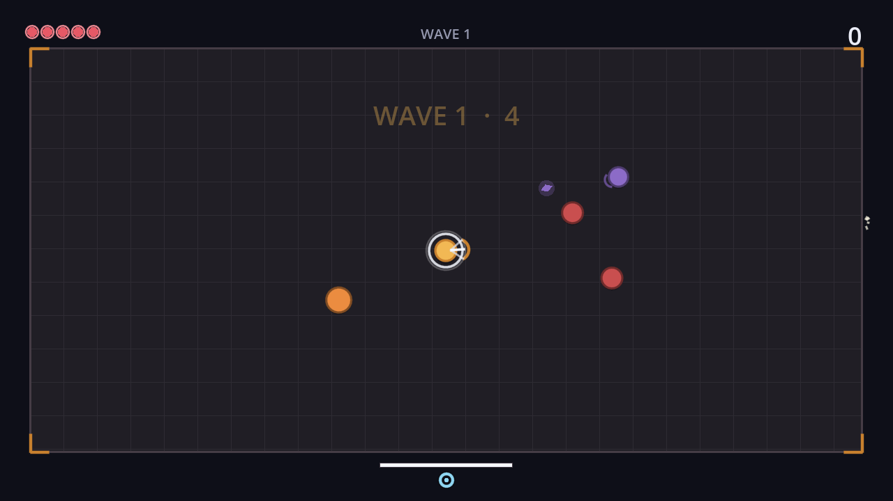

# Astra

A small arcade archery survival game, built in Godot 4. Hold to draw, release
to fire, and try not to stand still — drawing the bow slows you to a crawl.



MIT licensed, no third-party assets, and no art pipeline: every sprite in those
screenshots is drawn at runtime from circles, arcs and lines, and every sound
is synthesised by a 150-line Python script in `tools/`.

---

## Play

Clone it and open the folder in Godot 4.4 or newer, then press F5.

```bash
git clone https://github.com/novaprime-code/astra.git
cd astra
godot .                 # or: godot --path . scenes/main.tscn
```

CI builds a web version on every push and uploads it as a workflow artifact.
To get a public playable link, enable GitHub Pages for the repository
(**Settings → Pages → Source: GitHub Actions**) and the next push to `main`
will publish it.

### Controls

| Input | Action |
| --- | --- |
| `WASD` / arrows | Move |
| Mouse | Aim |
| Hold left click | Draw the bow; release to fire |
| `Space` | Dodge (brief invulnerability) |
| Right click / `Q` | Astra — a piercing volley in every direction |
| `Esc` | Pause |
| `R` | Retry, on the results screen |

## The one idea

Charge time is the whole game. A full draw hits roughly three times as hard as
a snap shot, but while you are drawing you move at 42% speed, and the enemy
walking at you does not care. Every other system exists to put pressure on that
single decision:

- **Chargers** telegraph before they dash, so you can dodge — but only if you
  are not committed to a draw.
- **Archers** keep their distance and force you to move toward them.
- **The combo multiplier** decays after two seconds without a kill, so playing
  safe costs score.
- **The astra** is the escape hatch, on an 11-second cooldown.

## Project layout

```
astra/
├── autoload/      EventBus, GameState, SaveManager, AudioManager
├── resources/     EnemyType resource class + one .tres per enemy
├── scenes/        Gameplay and UI scenes
├── scripts/       One script per scene, plus the shared Palette
├── tests/         Headless smoke test (83 checks)
├── tools/         Sound generator and screenshot renderer
└── docs/          Architecture notes and roadmap
```

There is **one** enemy scene and **one** enemy script. A footman, a charger and
an archer are the same scene holding a different `EnemyType` resource. Adding a
fourth enemy means writing a `.tres` file, not a class.

See [docs/ARCHITECTURE.md](docs/ARCHITECTURE.md) for why things are split the
way they are, and what would have to change to scale it up.

## Tests

The smoke test boots the real arena and asserts the things that would make the
game unplayable if they broke: the project loads, a wave starts, the bow fires,
enemies take damage and score, the player can die, and the walls hold.

```bash
godot --headless --path . res://tests/smoke_test.tscn
echo $?   # 0 on pass, 1 on failure
```

It runs on every push. It is not a unit-test framework and does not want to be
one; it is the test that catches the bug you would otherwise find at a jam, at
2am, with 40 minutes left.

## Regenerating assets

Both of these are reproducible and deterministic — re-running them on an
unchanged checkout produces no diff.

```bash
python3 tools/make_sounds.py                       # rewrites assets/audio/*.wav
godot --path . tools/screenshot.tscn -- docs/images  # rewrites the screenshots
```

The screenshot tool composes its shots in code, so it works on a headless
machine with a virtual display — which is how the images in this README were
produced.

## Why this exists

It is practice for a game jam, and a deliberately small one. Jam-sized scope is
a skill in itself: a finished three-enemy arena shipped on time teaches more
than a half-built epic.

The longer-term plan — an 18-day Kurukshetra game — lives in
[docs/ROADMAP.md](docs/ROADMAP.md), along with an honest account of which parts
of this codebase would survive that jump and which would not.

## Contributing

Issues and pull requests are welcome, including from people who have never
touched Godot. [CONTRIBUTING.md](CONTRIBUTING.md) lists a few deliberately
small, self-contained starting points.

## Licence

[MIT](LICENSE) © 2026 Jay Shyam Patel

All code, sounds and art in this repository are original. Godot Engine itself
is MIT licensed and is not bundled here.
